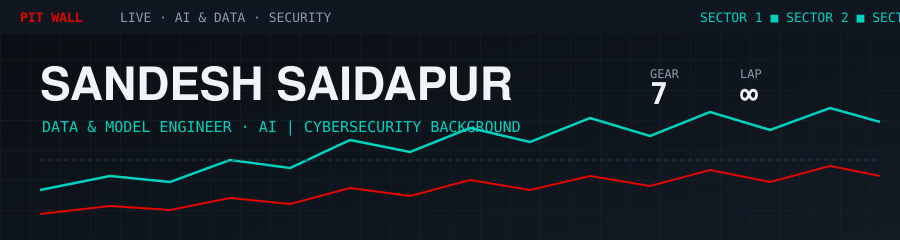

  

**Data & Model Engineer Intern @ AgilXAI** · **M.Sc. AI & Data Science** · **Cybersecurity background**

---

### 🏁 Race status

| Telemetry | Status |
|---|---|
| 📍 Location | České Budějovice, Czechia → **relocating to Germany by January 2027** |
| 🎯 Looking for | **Working student, internship, and graduate roles in AI & data science, anywhere in Germany** (no location restrictions) |
| 🛠️ Right now | Building several **AI projects, soon to be pushed to GitHub** |
| 🤝 Open source | **Contributing to open-source projects** |
| ✅ Work eligibility | Eligible for part-time work (student visa) |
| 🌍 Languages | English C2 · German B1 (improving) |

---

### 🎓 Education

- **M.Sc. AI & Data Science**, TH Deggendorf (Germany), 1st semester · Mar 2026 – expected Apr 2028
- **M.Sc. AI & Data Science**, University of South Bohemia (Czechia), 2nd semester · Sep 2026 – present
- **B.Tech. Computer Science & Technology**, Reva University, Bengaluru · 2019 – 2023

---

### 💼 Experience

**AgilXAI** · Data & Model Engineer Intern · Current

**IBM Corp.** · Security Analyst / Technical Consultant · Bengaluru, India · Feb 2023 – Feb 2026
- Protected SOC environments for banking clients across 2,000+ Windows, Linux, and AIX servers
- Handled around 50 security incidents per week under strict SLAs, including Sev1 and P1 incidents
- Tuned QRadar SIEM alerts, onboarded log sources, and built threat dashboards in QRadar Pulse
- Ran Trend Micro Deep Security and Qualys vulnerability scanning, with remediation tracking
- Wrote SOPs and runbooks, and supported KPMG compliance audits
- Recipient of the IBM Eminence in Delivery Award (2025)

---

### 🧪 Projects in progress

- **AI & data projects** I'm building now, to be pushed to GitHub soon
- **Industrial image classification (Krones challenge):** EfficientNetV2-S model that checks returnable bottles for damage. Built with PyTorch and timm, and optimized with ONNX and INT8 quantization.
- **Student performance prediction (end-to-end ML):** XGBoost and CatBoost pipelines, MLflow and DagsHub tracking, Flask API, Streamlit interface, Docker, and AWS Elastic Beanstalk deployment.
- **LSTM next-word predictor:** TensorFlow/Keras model with NLTK preprocessing and an interactive Streamlit app.
- **Agentic AI and RAG:** LangGraph, LangChain, Model Context Protocol (MCP), and AI guardrails.

### 🏆 Featured repositories

- 🔬 **[AI Research Paper App](https://github.com/sandesh-saidapur/sandesh-saidapur-ai-research-paper-app-)**: interface for parsing and exploring AI research literature.
- 📊 **[Data Analytics Projects](https://github.com/sandesh-saidapur/DataAnalytics-Projects)**: exploratory data analysis, statistical modeling, and analytical notebooks.
- ☁️ **[AWS Cloud Project](https://github.com/sandesh-saidapur/aws-project)**: cloud infrastructure and service deployment implementations.
- 🌦️ **[Weather Assistant](https://github.com/sandesh-saidapur/weather-assistant)**: containerized meteorological query microservice.
- 🚲 **[Bikes Dataset Predictive Modeling](https://github.com/sandesh-saidapur/R-project--bikes-dataset)**: statistical modeling and regression analysis in R.

---

### 🧰 Skills

- **AI & Data:** Python, PyTorch, TensorFlow, OpenCV, CNNs, Transformers, ONNX, MLflow, Pandas, NumPy, LLMs, RAG
- **Agentic AI:** LangGraph, LangChain, Model Context Protocol (MCP), AI guardrails
- **Cybersecurity:** IBM QRadar SIEM, Trend Micro, Qualys, Tanium, incident response, vulnerability management, CompTIA Security+
- **Cloud & DevOps:** Docker, AWS, Google Cloud Platform, Linux, Windows Server, IBM AIX, Git & GitHub

---

### 🏎️ Off track

Rugby · Football (soccer) · Cricket · Horseback riding · Sim racing · Motorsports · Martial arts

---

### 📈 Stats

  
  

---

**📬 Let's talk:** [sandesh.saidapur@gmail.com](mailto:sandesh.saidapur@gmail.com) · [LinkedIn](https://linkedin.com/in/sandesh-saidapur-5011b5191)

